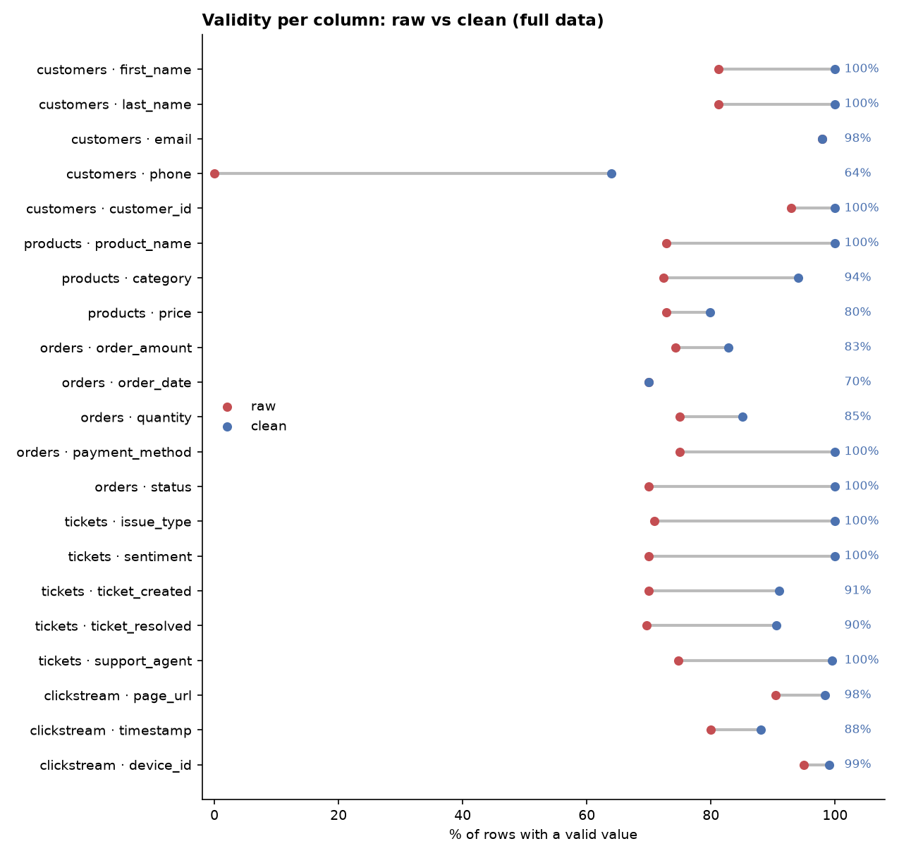
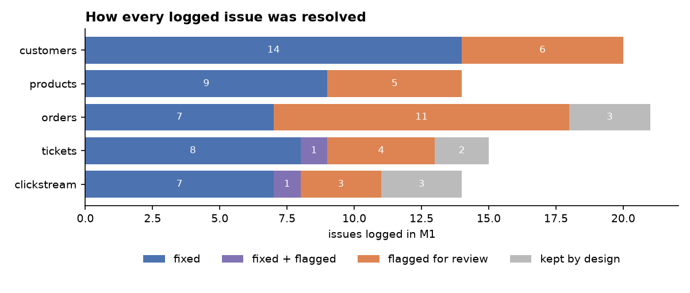

# Customer 360 · Data Cleaning with Excel, SQL and Python

**Author:** Arif Herfian Zaen Chartiko

End-to-end cleaning of a messy multi-source customer dataset: **5 tables, 880,500 rows**, cleaned in full (no sampling) with the tool that fits each job, and delivered as Excel, CSV and a PostgreSQL database, with a report that proves every change.



## The problem

A company keeps its customer data in five separate exports. None of them can be used for reporting as they are.

| Table | Rows | Typical problems |
|---|---:|---|
| Customers (CRM) | 50,000 | duplicate and conflicting profiles, `KKeevvin`-style typos, symbols in names, 21 phone formats, shared emails |
| Products | 500 | 46 spellings of 8 categories (`3l3ctronics`, `clo`, `home_`), placeholder prices (`1,200`, `-100`, `NaN`) |
| Orders | 300,000 | placeholder amounts, impossible and repeated placeholder dates, quantities like `five` and `-3`, 11 spellings of 4 payment methods |
| Support tickets | 30,000 | reversed text (`tnemyap`), impossible timestamps (`2025-12-12T28:77:10`), future dates, agent name typos |
| Clickstream | 500,000 | URLs in mixed case, without scheme, with extra slashes or a wrong path; 5 timestamp formats; events dated up to 2028; device IDs in 3 formats plus `invalid-device-N` placeholders |

## Results

| Table | Raw rows | Clean rows | Average validity before | After |
|---|---:|---:|---:|---:|
| Customers | 50,000 | 48,200 golden records | 70.7% | 92.4% |
| Products | 500 | 500 | 72.7% | 91.3% |
| Orders | 300,000 | 300,000 | 72.9% | 87.6% |
| Support tickets | 30,000 | 30,000 | 71.0% | 96.2% |
| Clickstream | 500,000 | 500,000 | 88.5% | 95.1% |

- **84 issues** found in profiling, **all 84 handled** and traced from issue to fix.
- **0 orphan records** and **0 duplicate keys** across all tables (15 integrity checks).
- **12,564 missing ticket timestamps recovered** exactly from `resolution_time_hours`, after proving the rule holds for all 14,586 complete tickets.
- Values that could not be proven were **set to null and flagged, never invented**. This is why some columns stop below 100%.
- The report shows **32 real before/after examples**, from `KKeevvin` → `Kevin` to `tnemyap` → `payment`.



## Which tool did what

| Step | Table | Tool | Highlights |
|---|---|---|---|
| M1 Profiling | all | pandas | every column read as text so no dirt is hidden; full 500k clickstream profiled in chunks; issue log with 84 issues |
| M2 Customers | customers | pandas | golden record per customer, doubled-letter typo repair verified against email, phone to E.164, device list split into its own table |
| M3 Products | products | Excel | native Power Query, `XLOOKUP` category map, `LET` + `IFS` price rules, dynamic `FILTER` review sheet, pivot tables; refreshable |
| M4 Orders | orders | pandas + NumPy | IQR outlier fences, placeholder detection from value frequencies, vectorised rules with `np.select` |
| M5 Clickstream | clickstream | pandas | 500,000 events cleaned chunk by chunk, canonical URLs and device IDs, all timestamps to UTC |
| M6 Tickets | tickets + all | SQL (PostgreSQL) | CTE pipeline with `TRIM`, `ROW_NUMBER`, `REVERSE`, `pg_input_is_valid`; cross-table integrity checks; full clean database |
| M7 Validation | all | pandas + matplotlib | same validity rule measured on raw and clean data; before/after examples; final report and data dictionary |

## Rules followed

1. Raw files are never modified.
2. Measure first, then clean.
3. Never guess a value: uncertain records are flagged, not invented.
4. Every fix is traceable to an issue in the issue log.
5. Full data only, no sampling.

## Deliverables

```
03_clean_data_and_report/
├── data_cleaning_report.xlsx      ← start here: guide, summary, before/after, examples, issues,
│                                     integrity checks, data dictionary, charts
└── clean_data/
    ├── customers_clean.xlsx       ← customers | customer_devices | flagged | merge_map
    ├── products_clean.xlsx        ← Power Query workbook with formulas and pivots
    ├── orders_clean.xlsx          ← orders | flagged | mappings
    ├── tickets_clean.xlsx         ← tickets | flagged
    ├── clickstream_clean.xlsx     ← clickstream | flagged
    ├── csv/                       ← the same clean data as UTF-8 CSV
    └── database/
        └── customer360_clean.dump ← PostgreSQL schema "clean" with all tables
```

Every flag has a type, so the client sees at once what really needs a decision:

| Flag type | Meaning |
|---|---|
| needs review | a person should check or decide (possible duplicate customer, amount outlier) |
| invalid or missing value | the source value was impossible, a placeholder or blank; it was removed and cannot be recovered |
| auto-fixed (info) | the value was repaired automatically; listed for transparency |

Flagged records are always kept, never deleted. Filter `needs_review = TRUE` to see what needs a decision.

## Reusable toolkit

`04_reusable_toolkit/profile_any_file.py` is the generic first step for a new cleaning job. Point it at a client's CSV, Excel or Parquet file and it writes an issue log in seconds: blanks, spaces, placeholders, duplicates, mixed date and ID formats, impossible and future dates, outliers, repeated default values, noise characters, doubled-letter typos, values packed in one cell, and the same category written in different ways (case, leetspeak, reversed text, abbreviations, one-letter typos).

```
python 04_reusable_toolkit/profile_any_file.py client_file.csv
python 04_reusable_toolkit/profile_any_file.py client_file.xlsx --sheet Orders --out profiles/
```

Large CSV files are read in chunks, so the full file is profiled (500,000 rows in about 30 seconds). The checks are heuristics: the output is a list of leads to confirm, not final truth.

## Repository structure

```
customer360-data-cleaning/
├── 01_data_and_task/
│   ├── raw_data/raw_data.zip      ← the 5 raw CSVs (zipped: one file is over GitHub's 100 MB limit)
│   └── task/project_brief.md      ← scope, rules and schedule
├── 02_process/                    ← one folder per milestone: notebook, SQL / Power Query code, output/ logs
├── 03_clean_data_and_report/      ← what the client receives
├── 04_reusable_toolkit/           ← profile_any_file.py for the next job
└── requirements.txt
```

## How to reproduce

1. Extract `01_data_and_task/raw_data/raw_data.zip` inside `raw_data/`.
2. `pip install -r requirements.txt` (tested with Python 3.14).
3. M3 needs Microsoft Excel 2021 or Microsoft 365 on Windows (Power Query automation, `XLOOKUP`, `LET`, `FILTER`).
4. M6 needs PostgreSQL 16 or newer; the password is read from `pgpass.conf`, never from code.
5. Run the notebooks in `02_process/` in order, M1 to M7.

To load the clean database: `pg_restore --no-owner -d <database> 03_clean_data_and_report/clean_data/database/customer360_clean.dump`

## Data

[Customer 360](https://www.kaggle.com/datasets/vinaykandimalla/customer-360) on Kaggle, CC0 public domain, synthetic data.
